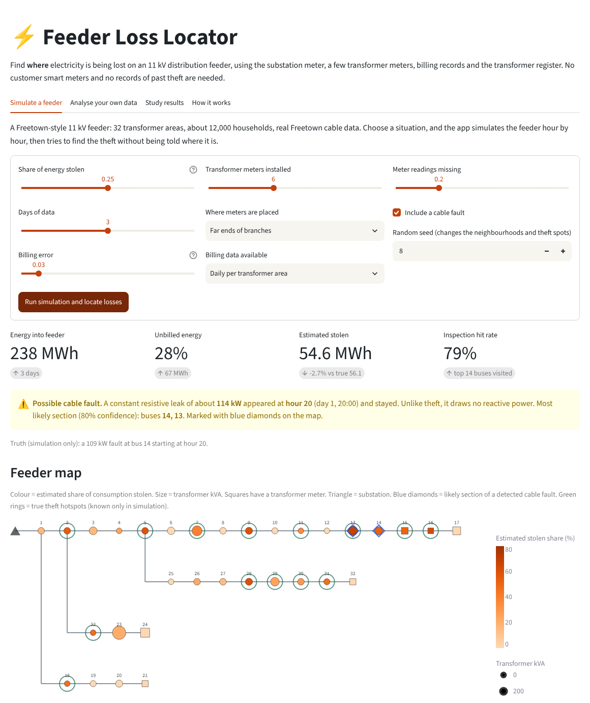
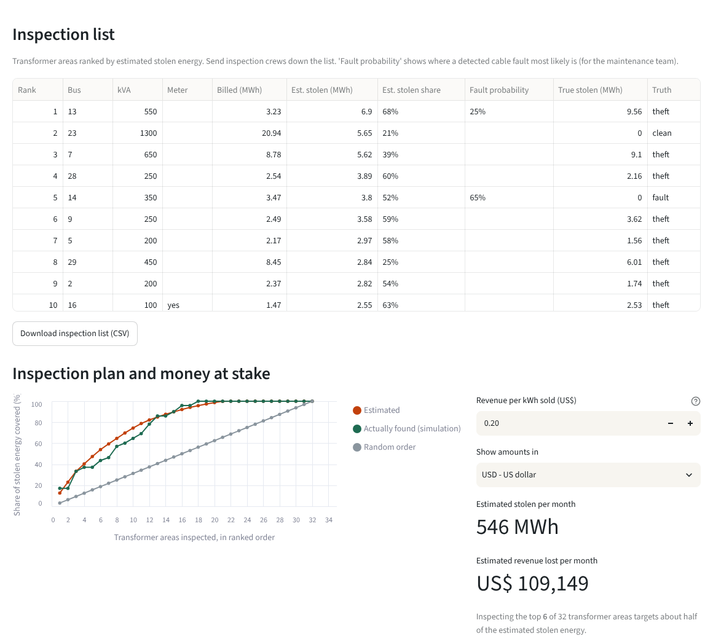
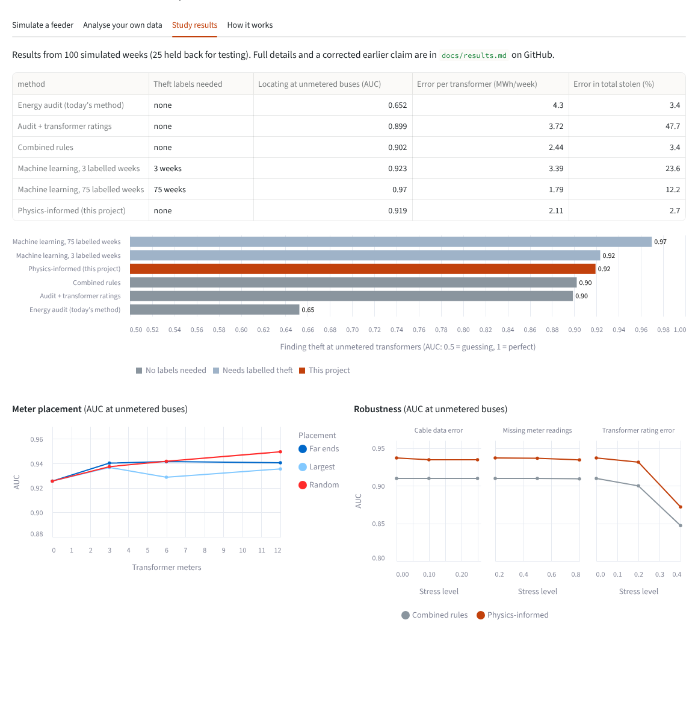

# sl-grid-piml

Physics-informed estimation for locating electricity losses (theft and faults)
on distribution feeders with very few meters, using a Sierra Leone 11 kV feeder as the case study.

**Interactive app:** https://sl-grid-piml.streamlit.app

**Project page:** https://alusine-bah.github.io/sl-grid-piml/

**Status:** simulation study and interactive app complete. Next step: a test on a real feeder.

## Screenshots

**Simulate a feeder:** choose a situation; the app finds theft hotspots and flags a cable fault
(blue diamonds) without being told where they are.



**Inspection list and plan:** transformer areas ranked for inspection crews, how much stolen
energy the top areas cover, and revenue at stake in a chosen currency.



**Study results:** how the method compares with today's energy audit, rule-based methods and
machine learning.



## Why
Sierra Leone's distribution utility (EDSA) loses roughly half of the electricity it buys to
technical and commercial losses. Most utilities in this situation have meters at only a few
points on each feeder. This project asks: with only a handful of meters, how well can we
find *where* power is being lost, and how much?

## Approach
1. Model an 11 kV radial feeder: the IEEE 33-bus layout rebuilt with real Freetown cable
   constants, a 33/11 kV substation transformer, and household demand from a 2023 Freetown survey.
2. Simulate realistic loads, theft hotspots, cable faults, and missing and noisy meter data.
3. Compare the standard energy audit, rule-based methods using transformer ratings, pure
   machine learning, and a physics-informed estimator that uses the feeder's power-flow equations.
4. Study how many transformer meters are needed, where to place them, and how robust each
   method is to missing readings and wrong asset data.

All data is simulated for now. The code uses one standard feeder format, so real utility
data can replace the simulator later without changing the models.

## The interactive app
`app.py` is a web app (Streamlit) that runs the real model:

- **Simulate a feeder:** choose the theft level, number and placement of transformer meters,
  missing readings, a cable fault and the number of days. The app simulates the feeder hour by
  hour, then locates the losses without being told where they are, and shows how close it got.
- **Analyse your own data:** upload CSV files describing one real feeder (line sections,
  transformer kVA, substation meter, transformer meters, and billing or prepaid vending records). Example files are in
  `data/example_feeder/` and can be downloaded from the app.
- Both modes give a **feeder map** coloured by suspected theft, a ranked **inspection list**
  (downloadable), an **inspection plan** (how much stolen energy the top N areas cover), the
  **revenue at stake** (in US dollars or 14 other currencies, with live exchange rates), and a
  comparison of methods.
- Billing can be daily, or one total per transformer area for the period (monthly bills), or
  **prepaid vending records**: the customer list (meter → transformer) and every token
  purchase. The app then works out sales per transformer area itself and also ranks
  **individual prepaid meters** for inspection.
- **Inspection rounds**: plan each round (top of the list + a 15% random audit, with
  every area's chance of selection on the work list), upload what crews found (ten outcome
  codes), and see hit rates with confidence intervals, a verdict on whether the model
  beats random visits, the estimated share of areas with theft, and calibrated
  probabilities for the next round.
- **Compare feeders**: rank several feeders (simulated, or uploaded as one .zip with a
  folder per feeder) by estimated theft and revenue lost, and plan where a limited number
  of inspection crews should go across all of them.
- Optional **smart-meter (AMI) readings of large customers**: the model uses their hourly
  sales and voltages, and ranks the large customers for tamper inspection with a chart of
  their daily use. Example files (prepaid + smart meters) are in `data/example_prepaid/`.
- A **load-shedding** setting simulates daily outages or the one-day-in-three rotation;
  uploaded data may simply leave outage hours out.
- A **cable-fault alert** gives the start hour, leak size and likely section of a new fault,
  marked on the map, so the tool serves the maintenance team as well as the revenue team.

Run it locally with `streamlit run app.py`.

## Setup (Windows PowerShell)
```
python -m venv .venv
.\.venv\Scripts\Activate.ps1
pip install -r requirements.txt
pip install -e .
pytest
python scripts\run_base_powerflow.py
python scripts\run_freetown_day.py
python scripts\generate_dataset.py --scenarios 100 --days 7
python scripts\run_experiments.py
python scripts\run_studies.py
python scripts\run_billing_study.py
python scripts\run_fault_study.py
python scripts\run_shedding_study.py
python scripts\run_prepaid_study.py
python scripts\run_ami_study.py
python scripts\run_district_study.py
python scripts\run_inspection_study.py
```

## Grounded in Sierra Leone data
Every parameter is traced to a published source in [`docs/sources.md`](docs/sources.md), including:
- Household appliance ownership and hourly use in Freetown (Rogers et al., 2024)
- Real Freetown 11 kV cable and line constants and substation transformers (JICA, 2009)
- Freetown network structure and measured weak-bus voltages (Mansaray et al., 2024)
- Sierra Leone loss levels from five sources (30–53%)

## The Freetown-style feeder (default settings)
| Quantity | Value | Basis |
|---|---|---|
| Line length | 50 km, 29% underground | JICA area lengths (22–76 km) |
| Customers | 12,000 households (~54 transformers) + 1.2 MW commercial | ~220 households per transformer |
| Peak load | ~4.3 MW | one 11 kV main line carries ~5 MW |
| Lowest voltage at peak | ~0.90 pu | measured Freetown weak buses 0.87–0.90 pu |
| MV technical losses | ~3% of energy | MV network losses 4.8% |

## Scenarios: what is simulated and what the utility sees
- **Theft:** at a set of hotspot buses, 15%, 25% or 35% of all delivered energy is stolen
  (Sierra Leone commercial losses: 18–40%). The feeder load stays realistic; theft only
  changes how much is billed.
- **Cable faults:** in 30% of scenarios, a constant leakage of 40–150 kW starts at a random hour.
- **Load shedding (optional):** daily 4 h or 8 h outages, or supply one day in three, with
  extra demand when supply returns (cold load pickup).
- **The utility's view:** a feeder-head meter, six transformer meters with 2% noise and 20%
  missing readings, and daily billing per transformer area. No customer smart meters.

See [`docs/data_format.md`](docs/data_format.md) for the exact data a utility would need to
provide to run the models on a real feeder.

## Results
On 25 test scenarios (full log, including a corrected earlier claim, in [`docs/results.md`](docs/results.md)):

| Method | Theft labels needed | Finds theft at unmetered transformers (AUC) | Error per transformer (MWh/week) | Error in total stolen energy |
|---|---|---|---|---|
| Energy audit (standard utility method) | none | 0.65 | 4.30 | 3.4% |
| Combined rules: ratings + meters + feeder gap | none | 0.90 | 2.44 | 3.4% |
| Pure ML | 3 labelled weeks | 0.92 | 3.39 | 23.6% |
| Pure ML | 75 labelled weeks | 0.97 | 1.79 | 12.2% |
| **Physics-informed (this project)** | **none** | **0.92** | **2.11** | **2.7%** |

### Main findings
1. **The biggest, cheapest win needs no new hardware:** combining the transformer asset
   register with the feeder-head meter raises theft localisation at unmetered transformers
   from 0.65 to 0.90 AUC compared with today's energy audit.
2. **The physics-informed model adds a consistent further gain** with no theft labels:
   the best label-free localisation (0.92), 14% lower error per transformer, and the most
   accurate total of any method that can locate theft. It matches ML trained on three
   weeks of labelled theft data, which utilities like EDSA do not have.
3. **Robust where it matters for Sierra Leone:** losing 80% of meter readings or 25% errors
   in cable data barely affect it. An out-of-date transformer register hurts every method,
   so **keeping the asset register accurate matters more than buying extra meters.**
4. **Works with monthly bills and prepaid sales.** One billing total per transformer area for
   the period locates theft as well as daily figures (AUC 0.915 vs 0.916). Billing errors of
   10-20% mainly reduce accuracy of the stolen *amount*, not of its location.
5. **Tells cable faults apart from theft.** A leaking cable draws real power but no reactive
   power, unlike stolen household load. A detector built on this caught 28 of 30 faults with
   no false alarms in 30 clean weeks (held-out test), timed their start to the hour, and
   narrowed the location to a section of about 8 of 32 buses (location AUC 0.91, up from
   0.57-0.68).
6. **Survives load shedding.** With daily 4-8 hour outages, or supply only one day in three
   (about 26 hours a week), theft is still located at 0.91-0.94 AUC and the total stolen
   estimated within 4%. Under heavy rationing, cable faults are mostly missed in a single
   week, so a month or more of data is advised.
7. **Uses prepaid vending records directly and points to individual meters.** From the
   customer list and every token purchase, it works out sales per transformer area (30-day
   average) and ranks prepaid meters. Of the top 100 meters, 70% really bypass, against 21%
   of all meters and 31% when ranking by low buying alone. With 20% of meters linked to the
   wrong transformer, area localisation falls from 0.93 to 0.87 AUC, so cleaning the
   customer database is worthwhile.
8. **Finds tampered smart meters of large customers.** From hourly smart-meter readings, a
   lasting drop in use or a peak far below the contracted capacity, weighted by the feeder
   model, puts 85% of tampered large-customer meters at the top of the list. Adding one check
   meter on each large-customer transformer pins the stolen energy in those areas to within
   1% (from about 20%).
9. **Plans inspection crews across a whole district.** With crews for 10% of a district's
   transformer areas, sending them to the highest-theft areas across all feeders reaches
   47% of the stolen energy, against 40% with equal crews per feeder and 30% when crews
   concentrate on the feeders with the most unbilled energy. Ranking whole feeders works
   equally well with unbilled energy in this simulation (rank correlation 0.97 for both).
10. **Inspection rounds that measure themselves.** Each round sends 85% of crews to the top
    of the list and 15% to random areas, with every area's chance of selection logged.
    In a closed-loop test this reached 91% of the theft of pure top-of-list targeting, and
    it was the only policy that both proved it beats random visits and estimated the true
    share of areas with theft (36.6% against 36.7%). Pure targeting would have reported
    95%. Logged outcomes also calibrate the displayed probabilities: starting from a wrong
    map, calibration halved the error.

**How it works:** for each feeder, it finds the theft pattern that best explains the
substation meter, a few transformer meters and the billing records, while obeying the
feeder's power balance and the voltage drop through its real cables (checked against full
AC power flow). Transformer kVA ratings give it a starting guess. It runs in 5-20 seconds
per feeder-week on a laptop.

## Layout
- `src/slgrid/feeder.py` — base IEEE 33-bus feeder and the standard feeder format
- `src/slgrid/freetown.py` — the Freetown-style feeder
- `src/slgrid/loads.py` — household and commercial demand profiles
- `src/slgrid/simulate.py` — time-series power flow
- `src/slgrid/anomalies.py` — theft and fault injection with labels
- `src/slgrid/metering.py` — what the utility observes (meters, billing, noise, gaps)
- `src/slgrid/dataset.py` — labelled dataset generator
- `src/slgrid/topology.py` — network position features from the line list
- `src/slgrid/evaluation.py` — common metrics for all methods
- `src/slgrid/baselines.py` — energy audit, ratings rules, and pure ML baselines
- `src/slgrid/physics_model.py` — the physics-informed locator
- `src/slgrid/studies.py` — meter placement and robustness helpers
- `src/slgrid/faults.py` — cable-fault detector (start time, size, location)
- `src/slgrid/io.py` — reads and checks a utility's own feeder files
- `src/slgrid/app_core.py` — back end of the app (simulate, locate, feeder layout)
- `app.py` — the interactive app
- `data/example_feeder/` — example feeder in the upload format
- `data/sources/` — data extracted from published sources
- `docs/sources.md` — citations and how each number is used
- `scripts/` — runnable experiments
- `tests/` — checks that the physics and calibration are correct
